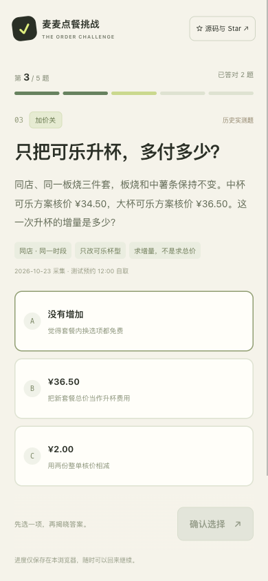
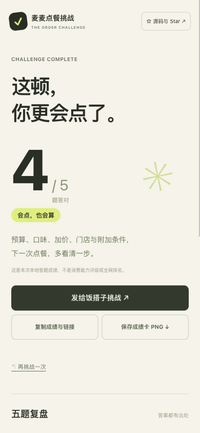

# 麦麦点餐挑战

**这单，你会怎么点？5 道真实点餐题，答完就知道。**

## [手机直接开玩 →](https://yemin11238.github.io/mcd-order-challenge/)

免登录、免 Token，约两分钟一局。选答案 → 看解析 → 查证据 → 分享成绩，让饭搭子做同一套题。

适合想看懂套餐选项和价格条件的普通食客，也适合拿来向朋友演示 MCP 如何支持具体的点餐判断。

页面使用**官方 MCP 历史实测记录，非实时查价，不下单**。采集于 2026-10-20、2026-10-23；10 月 23 日新增案例明确使用测试预约 12:00 的菜单和报价，没有创建预约或订单。

[](https://github.com/YEMIN11238/mcd-order-challenge/actions/workflows/checks.yml)

<p></p>

[作品短介绍与演示步骤](docs/share.md) · [逐题证据](docs/evidence.md)

## 五关，看清五件事

| 关卡 | 你要判断什么 | 真实数据支撑 |
|---|---|---|
| 预算关 | 35 元以内，中薯还是大薯？ | 同店两份整单核价 ¥34.50 / ¥37.00 |
| 口味关 | 便宜 1 元，能替你换掉必须的小食吗？ | 同套餐门店选项差异；原小食 ¥37 / 改大薯 ¥36 |
| 加价关 | 中杯可乐换大杯，多付多少？ | 同条件报价 ¥34.50 → ¥36.50，差额由代码相减 |
| 换店关 | 同搭配、同时段，两家一定同价吗？ | 两店大薯＋中杯可乐方案 ¥37 / ¥36 |
| 压轴关 | 菜单写 ¥28，这次真付 ¥28 吗？ | 带“随单购麦金卡优惠”条件的菜单展示价，与本次不随单购卡核价 ¥57 |

**剧透区：[逐题答案、请求与 traceId](docs/evidence.md)。** 错选项是待判断的说法，不是额外的官方报价。

## 为什么做成挑战

预算内、原样保留、优惠条件满足，是三件不同的事。这个作品把它们放进具体选择中：便宜的方案可能改了必须项，套餐里的选项变化可能影响总价，有附加条件的菜单价也不一定是本次应付。

每题先选再揭晓。答错时说明原因，答完可展开五题复盘。成绩只表示本次答对几题，没有虚构全网排名或“击败多少人”。

## 手机上能做什么

- 五道单选题，确认后揭晓答案，不能连点重复计分。
- 每题提供真实数据抽屉，展示采集时间、测试预约、核价金额与官方 traceId。
- 本浏览器保存进度，刷新后可续答；不上传姓名、手机号或个人餐单。
- 完成后复制成绩与同题链接、使用系统分享，或导出 1080 × 1440 PNG 成绩卡。
- 同题链接携带题库版本；版本不匹配会提示，避免跨版本比较成绩。

## 真实 MCP 集成

服务为 `https://mcp.mcd.cn`。新增实测包含 12 次业务调用、5 次核价；另复用作者此前项目的 5 条历史证据，其中 2 条是报价。当前公开证据共 17 条业务记录、7 次成功核价。

查询了 `now-time-info`、`query-nearby-stores`、`query-meals`、`query-meal-detail`、`calculate-price`。每道题的事实、金额、采集时间、traceId 与 SHA-256 都能核对。答案从响应计算，改动证据导致答案不唯一或对比条件不一致时，构建会停止。

完整流程与边界见 [MCP_INTEGRATION.md](MCP_INTEGRATION.md)。官方参赛声明保持原文；未使用 WorkBuddy，不伪造 `workbuddy.md`。

## 本地体验与验证

Python 3.9+ 用于证据校验与采集；浏览器端为原生 HTML/CSS/JavaScript，无第三方运行依赖。克隆需要联网，已有题库的构建和测试不需要 Token 或网络：

```bash
git clone https://github.com/YEMIN11238/mcd-order-challenge.git
cd mcd-order-challenge
python3 scripts/build_quiz.py --check
python3 -m unittest discover -s tests -v
node --test tests/model.test.mjs
python3 -m http.server 8769 --directory web
```

打开 `http://localhost:8769`。Node.js 18+ 仅用于测试；游玩不需要安装 Node.js。

## 作为 Skill 使用

将目录放进宿主的技能目录，以 `mcd-order-challenge` 命名，或直接读取根目录 `SKILL.md`。

> 使用麦麦点餐挑战，给我逐题出题，选完再解释。答完告诉我正确题数，并给出证据。

也支持维护新题。真实采集只读取当前进程环境中的 `MCD_MCP_TOKEN`；不要写入公开代码或报告。私有环境配置好后，例如：

```bash
python3 scripts/collect_evidence.py --reservation "2026-10-23 12:00"
```

这里的日期是开发时的技术测试示例，请按明确测试目的使用当前可查询时段。输出默认在 `.mcd-private/`，仅生成新的候选证据，不替换已发布题目。发布前需复核、脱敏、更新构建规则与题库版本。

## 数据与范围

核价确认的是本次参数下的套餐、数量与总金额，未逐项回显全部特制，未验证实际出餐。套餐选项没找到不能推断全店缺货、永久停售或原因。测试只覆盖上海两店的有限套餐，不宣称全国同价或全局最低价；没有测试购卡后的整单费用。

页面没有 MCP 代理、广告或访问统计；访客不必提供账号凭证。题目与答案在静态文件中公开，可查源码；本项目没有带奖品的答题排名。

## 来源与许可

独立开发的麦当劳程序员创意开发大赛参赛作品，非麦当劳官方产品。

10 月 20 日的历史记录与只读传输层来自作者自己的 [mcd-usual-migrate](https://github.com/YEMIN11238/mcd-usual-migrate)（MIT）。本项目新增题库构建、证据校验、答题状态、计分、复盘、分享卡与手机界面。上游归属见 [THIRD_PARTY_NOTICES.md](THIRD_PARTY_NOTICES.md)。

自研代码与原创文档采用 [MIT License](LICENSE)。官方声明、业务响应与第三方商标遵循各自权利，不因本项目许可而重新授权。

觉得这几道题有用，欢迎 Star 收藏，或在 Issue 提交一个可验证的新案例。**游玩和查看证据不以 Star 为条件。**
